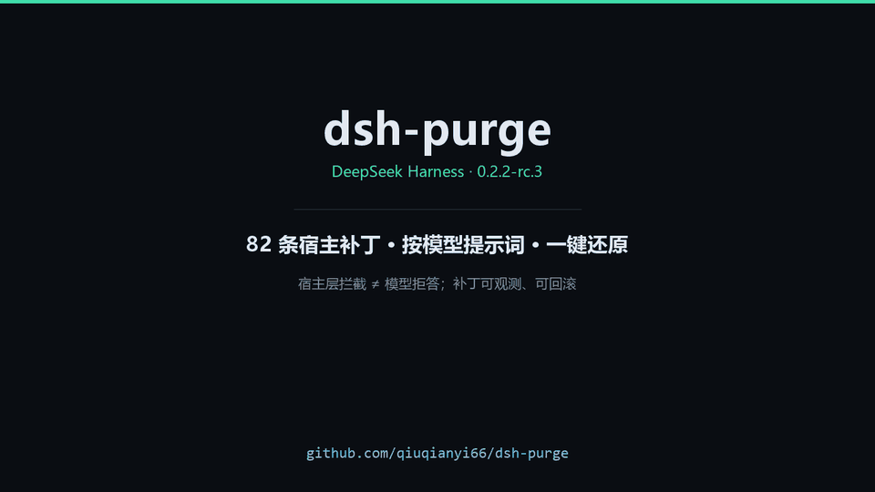

<div align="center">


# dsh-purge

**DeepSeek Harness 的本机红队评测插件：82 条宿主补丁 + 按模型提示词，一键还原。需 DSH `0.2.2-rc.3`、Node ≥ 18。**

[](LICENSE)
[](https://github.com/qiuqianyi66/dsh-purge/releases/latest)
[](https://github.com/qiuqianyi66/dsh-purge/actions/workflows/test.yml)
[](https://github.com/qiuqianyi66/dsh-purge/stargazers)
[](https://www.deepseek.com/harness/)
[](package.json)
[](lib/core.js)
[](compat.json)
[](https://m8ven.ai/mcp/qiuqianyi66/dsh-purge?s=readme)
[](https://m8ven.ai/mcp/qiuqianyi66-dsh-purge-zqj82m7v=readme)

**使用前必读：** 本项目只允许在**你自己拥有、且已获授权**的本机环境里用于安全评测。授权与版权条款见 [§1](#1-授权版权与再分发)，安全红线见 [§2](#2-安全边界红线)。不满足就别装。

<p align="center">
  
</p>

<p align="center"><sub>▲ 23 秒 · 画面全部取自真实命令输出（2026-11-16 本机实测）· <a href="docs/demo/dsh-purge-demo.mp4">下载 MP4</a> · 复现：<code>python scripts/render-demo.py</code></sub></p>

[版权与授权](#1-授权版权与再分发) · [安全边界](#2-安全边界红线) · [速览](#0-30-秒速览可直接引用) · [安装](#4-安装三分钟) · [能力](#6-能做什么) · [兼容与实测](#7-兼容性与实测数据2026-11-16) · [自检](#8-升级前自检与漂移诊断) · [FAQ](#11-常见问题)

</div>

---

## 0. 30 秒速览（可直接引用）

> dsh-purge 是 **DeepSeek Harness（DSH）的本机红队评测插件**：用 82 条分组宿主补丁和按模型替换的提示词，把「宿主层策略拦截」和「模型层拒答」分开观测；每个被改文件先备份、可一键还原；升级宿主前能用离体审计判断会不会静默失效。

三句话讲清楚它：

1. **规模**：82 条补丁，分布在 65 个载体键（宿主里被改写的具体文件），覆盖 Web 与桌面两个 surface。
2. **依赖**：目标宿主 DSH `0.2.2-rc.3`，Node.js ≥ 18，装进 profile 的 `node_modules`，不装全局、不碰远程仓库。
3. **证据**：2026-11-16 真机 `--diagnose` = 42 条文件核验命中 + 29 条运行时注入 + 7 条本机无载体 + 4 条退役，**改过原文 0 / 载体缺失 0 / 部分副本未清洗 0**；`node --test` 209 通过。

| 快速事实 | 值 |
| --- | --- |
| 项目名 / 仓库 | `dsh-purge` · [qiuqianyi66/dsh-purge](https://github.com/qiuqianyi66/dsh-purge) |
| 当前版本 / 宿主目标 | `1.2.0` / DSH `0.2.2-rc.3`（`dshTarget` 同值） |
| 许可证 / 上游版权 | Apache-2.0 · Copyright 2026 YuJunZhiXue（见 [`NOTICE`](./NOTICE)） |
| 运行前提 | Node.js ≥ 18；DSH 桌面版或官方 `dsh web`；pnpm |
| 安装一条命令 | `dsh plugin --profile desktop add https://codeload.github.com/qiuqianyi66/dsh-purge/tar.gz/refs/heads/main` |
| 机器可读入口 | [`compat.json`](./compat.json)（版本 / 矩阵 / 证据） · [`llms.txt`](./llms.txt)（给 AI 检索的摘要） |
| 演示 | [`docs/demo/dsh-purge-demo.gif`](docs/demo/dsh-purge-demo.gif)（23 秒，真实命令输出） |
| 常用检索词 | DSH 破甲插件 · DeepSeek Harness 插件 · 宿主补丁 · 提示词注入 · jailbreak / red-team evaluation · LLM security |

**建议路径：** [§4 安装](#4-安装三分钟) → [§7 兼容与实测](#7-兼容性与实测数据2026-11-16) → [§8 升级前审计](#8-升级前自检与漂移诊断)。

---

## 1. 授权、版权与再分发

**许可证：** [Apache License 2.0](./LICENSE)。程序按「现状」提供，不附带任何明示或暗示担保。

**上游版权（不可删除）：** 本项目的代码基础来自 `dsh-purge` 原作者 **YuJunZhiXue**（Copyright 2026），其版权声明与许可条款完整保留在 [`LICENSE`](./LICENSE) 与 [`NOTICE`](./NOTICE) 中。这是 Apache-2.0 第 4 条的硬性要求，删掉即构成侵权，不是可选项。当前适配与分发由 [@qiuqianyi66](https://github.com/qiuqianyi66) 维护，自 `1.1.84-rc1` 起负责 DSH 版本适配、补丁矩阵与验证证据。

**本仓库自有内容：** 除 `LICENSE` / `NOTICE` 内的上游版权声明外，本仓库的 README、图示、脚本、兼容矩阵、审计与验证流程、命令示例均为本仓库独立撰写与重做，不再沿用上游文档与素材。

**允许：** 阅读、部署到自有设备、修改自用、按 Apache-2.0 再分发（含商业使用）。

**再分发与二次开发必须做到：**

1. 保留 `LICENSE` 全文与 `NOTICE` 原样，不删、不改、不合并进别的声明；
2. 显著标注来源仓库 <https://github.com/qiuqianyi66/dsh-purge> 与上游作者 YuJunZhiXue；
3. 写明你改了什么（Apache-2.0 §4(b)）；
4. 不改名冒充原创、不声明为本项目官方版本。

**明确禁止：** 收费转卖、换皮上架、打包进付费群/网盘售卖、移除版权与来源声明后据为己有。违反者其许可依 [§2](#2-安全边界红线) 第 8 条自动终止，权利人保留追责权利。

**独立性：** 本项目与 DeepSeek 官方及其关联主体无隶属、无合作、无背书关系。文中「官方」仅指**评测对象**是你本机安装的官方 DeepSeek Harness 软件包。

---

## 2. 安全边界（红线）

本项目是**评测工具**，不是攻击平台。以下边界由代码强制，不由文字说明放宽。

**允许的用途：** 你本机已安装的官方 DSH；离线合成靶标；你已取得书面授权的实验室、靶场或自有内网环境。

**禁止的用途：** 未授权的任何他人系统；公网在线目标；生产业务系统；游戏外挂与作弊工具；作为跳板对外发包；生成违法违规内容。

**代码层硬约束：**

| 约束 | 实际行为 | 依据 |
| --- | --- | --- |
| 目标范围 | 攻击任务只放行本机回环与 RFC1918 私网 | `lib/redteam/` 目标判定 |
| 域名判定 | 先解析成 IP 再判断，不认 `.lab` / `.htb` 之类的后缀 | 同上 |
| 扩权通道 | 密钥、密码、网段、通配符、对话里的口头授权，都不能增加例外 | 同上 |
| 下发内容 | 开源版**不**下发技能库与知识库；未授权时演练台标「未授权」 | 面板 / 演练台 |
| 注入范围 | 密封的 `host-commands` / `runtime-commands` 会被清洗，永不注入 | 提示词注入链路 |
| 写入范围 | 只写你本机 `$DSH_HOME` 与 profile 指向的 `@deepseek-ai` 包，每个文件先备份 | 应用 / 还原 |

**责任与免责：** 使用者对自己的一切下载、部署、运行、修改、传播行为及由此产生的后果独立承担全部法律责任。作者与贡献者不承担任何连带责任。**若你的用途不在上面的「允许」范围内，请立即停止并删除本项目。**

**违约终止：** 将本项目用于非法攻击、恶意活动或绕过上述约束的，其使用许可自违规行为发生之日起自动且不可撤销地终止；须立即停止使用并销毁全部副本与衍生数据。

---

## 3. 这是什么，不是什么

**是什么：** 装在你本机 DeepSeek Harness 里的插件。它把「宿主层策略拦截」和「模型层回答」拆开观测：宿主改了系统提示词、审批门、沙箱策略、会话格式，同一句问题在两处被拦下的表现几乎一样，这个插件让它们可分辨、可回滚。附带本地靶场与规则集，用于受控的鲁棒性评测。

**不是什么：**

- **不是**通用越狱服务或在线代理，不对外提供任何接口；
- **不是**公网渗透框架，仓库内不含公网扫描器或对外载荷；
- **不是**模型微调或权重修改工具，只改本机宿主侧的明文文件；
- **不是** DSH 官方组件，官方升级不会替你保留补丁；
- **不是** npm 上的包 —— npm 仓库没有 `dsh-purge` 这个名字，`pnpm add dsh-purge` 必然失败；
- **不是** 一键换肤或美化插件，界面改动只是副作用。

---

## 4. 安装：三分钟

**前提：** 已装 DeepSeek Harness `0.2.2-rc.3`（桌面版或官方 `dsh web`），Node.js ≥ 18，pnpm 可用（宿主自带）。

**第 1 步 · 装插件**（桌面版把 `desktop` 换成你实际在用的 profile；Web 版用 `web`）

```sh
dsh plugin --profile desktop add https://codeload.github.com/qiuqianyi66/dsh-purge/tar.gz/refs/heads/main
```

压缩包地址必须写成 `codeload.github.com`；写成 `github.com/.../archive` 会 302 跳转，pnpm 直接报 `fetch failed`。

**第 2 步 · 核对装上了没**（在 `$DSH_HOME` 下执行，期望输出 `1.2.0`）

```sh
node -p "require('./profiles/desktop/node_modules/dsh-purge/package.json').version"
```

**第 3 步 · 核对宿主会加载它**（两条都命中才算装对）

```sh
node -p "require('./profiles/desktop/package.json').dsh.profile.bundles.includes('dsh-purge')"   # 期望 true
findstr /C:"id: dsh-purge" "%USERPROFILE%\.dsh\profiles\desktop\cordis.patch.yml"               # 期望有输出
```

缺 bundle 或 insert 时，补一条命令即可：

```sh
node node_modules/dsh-purge/scripts/ensure-profile-bundle.mjs
```

**第 4 步 · 完全退出宿主再打开**（桌面版连托盘一起退），会话标题旁会出现 **dsh-purge** 按钮。点它 →「清洗」→「应用」。

**只有 pnpm 没有 `dsh` 时：**

```sh
cd "$DSH_HOME/profiles/desktop"
pnpm add --allow-build=dsh-purge --allow-build="dsh-purge@https://codeload.github.com/qiuqianyi66/dsh-purge/tar.gz/refs/heads/main" https://codeload.github.com/qiuqianyi66/dsh-purge/tar.gz/refs/heads/main
```

pnpm 11/12 默认拦截安装脚本（`ERR_PNPM_IGNORED_BUILDS`），所以必须带 `--allow-build`；已经装完只报警告时，用带完整地址的形式补授权：`pnpm approve-builds "dsh-purge@https://codeload.github.com/qiuqianyi66/dsh-purge/tar.gz/refs/heads/main"`。

**三条常见拦路石：**

- 插件市场 / 设置里的一键安装会报 `already queued: dsh-purge` —— 不要走市场；
- 本机存在两份 `.dsh` 时，容易改到没在跑的那份 —— 回到上文用 `DSH_HOME` 指到你实际启动的那个；
- 装完不出现按钮，九成是第 3 步的 insert 没写进去。

---

## 5. 装好之后：能看到的三个入口

**面板**（会话标题旁）：清洗页看 82 条补丁的分组状态，可应用 / 还原 / 卸载、编辑提示词、切换规则集与外观；演练台管本地靶场资产。

**命令行**（在 profile 里执行 `node node_modules/dsh-purge/bin/dsh-purge.js <参数>`）：

```sh
--status                  # 当前补丁与规则集状态
--diagnose [--json]       # 只读：逐条补丁的漂移诊断
--preupdate [--json]      # 只读：升级宿主前的预检
--apply / --revert / --uninstall / --edit
```

**聊天命令与模型工具：**

```text
/purge status | apply | revert | uninstall | edit | help
/rules list | use <id> | create <id> | delete <id> | reset
/skills list | import <路径> | create <id> [说明] | delete <id>
/rewind

purge_status   purge_apply   purge_revert
```

`/rewind`、`/purge`、`/rules`、`/skills` 被别的插件占用时会改挂备用名；主插件工具与 `/dsh-purge/*` 路由不受影响。

---

## 6. 能做什么

| 能力 | 你得到的可见结果 | 依据 |
| --- | --- | --- |
| 分组补丁 | 82 条补丁按组展示，逐条能看「已生效 / 待应用 / 漂移 / 载体缺失」 | `lib/core.js`、面板清洗页 |
| 覆盖规模 | 82 条分布在 65 个载体键（宿主里的具体文件） | `lib/core.js` 统计 |
| 按模型提示词 | 不同模型挂不同系统提示词，规则集可切换、可还原 | `prompt-inject.md` 链路 |
| 一键还原 | 每个被改文件应用前备份为 `.dshpurge.bak`，还原即覆盖回去 | 应用 / 还原实现 |
| 升级前审计 | 按官方 npm 包铺隔离树逐条试补丁，报「需重对齐 0」才建议升级 | `scripts/audit-next.mjs` |
| 漂移诊断 | 官方原文变了会明说「漂移」，不会假装打上 | `--diagnose` |
| 本地靶场 | 只放行回环与 RFC1918，域名先解析再判 IP | `lib/redteam/` |
| 版本对照 | 宿主版本、兼容矩阵、证据级别由机器生成，README 与 CI 同源 | `compat.json` ← `lib/compat-matrix.js` |

四类补丁样本，说明它到底在改什么：

| 补丁 | 改的是 |
| --- | --- |
| #82 | 双击桌面 exe 常缺 `DSH_PROFILE`，主进程补兜底；锚点只锚 import 单行，兼容 rc.3 的 region 插入 |
| #13 / #35 | 沙箱升级阶梯与「从不拒绝」判定；rc.2 起换成 `SandboxEscalationError` 错误码形态 |
| #62 | 官方工具审批 `serviceAsk` 的 fail-open 分支；rc.2 起改走 `approvalDenial(...)` |
| #36 | `sandbox_permissions` 的 justification 文案，含 rc.2 新增的 `Required with … this exact …` 整句 |

---

## 7. 兼容性与实测数据（2026-11-16）

**当前版本 `1.2.0` 的靶子是 DSH `0.2.2-rc.3`**（`package.json` 的 `dshTarget` 同值）。`0.1.x`、`0.2.1-rc.x` 不在本版本目标内，需要旧版本请到 [Releases](https://github.com/qiuqianyi66/dsh-purge/releases) 取对应标签。

<!-- compat:table:start -->
| dsh 版本 | 本仓库版本 | 证据 | 说明 |
| --- | --- | --- | --- |
| **0.2.2-rc.3** | **1.2.0** | 契约✓ 实打✓ 冒烟✓ 真机✗ | rc.3 桌面版起把运行时打进 resources/app.asar；面板「应用」会自动解包、挪走 asar、重启。rc.2 引入 SandboxEscalationError / approvalDenial 新原文，rc.2 与 rc.3 四个载体文件逐字节一致 |
| **0.2.2-rc.1** | **1.1.88** | 契约✓ 实打✓ 冒烟✓ 真机✗ | 只有 rc.1 能用旧 pattern；rc.2 起（含 rc.3）需要 1.1.89 的新 pattern，装 1.1.88 会静默失配 |
| **0.2.1-rc.x** | unknown | — | 不是本版本目标；到 [Releases](https://github.com/qiuqianyi66/dsh-purge/releases) 选对应旧标签 |
| **0.2.0-rc.2** | **1.1.40+** | — | 旧线，见 [Releases](https://github.com/qiuqianyi66/dsh-purge/releases) |
| **0.1.7** | **1.1.39-** | — | 旧线（含 rc.1 / rc.2），在 [Releases](https://github.com/qiuqianyi66/dsh-purge/releases) 选对应标签 |
<!-- compat:table:end -->

**四个证据级别，不合并成一句「支持」：**

| 级别 | 含义 | 怎么产生的 |
| --- | --- | --- |
| 契约 | 官方包原文与补丁 pattern 逐条对齐 | `npm run audit:next -- --version <版本>` |
| 实打 | 在隔离树里真打一遍，产物过语法检查 | 同上（`--apply` 模拟） |
| 冒烟 | 真宿主上 `--diagnose` 漂移 0 且能启动 | 本机 `--diagnose` |
| 真机 | 应用到真宿主并完成面板 / 按钮人工验收 | 只能由人操作 |

**rc.3 桌面版换了打包方式，这是升级时必须知道的一件事：** 整个 dsh 运行时被塞进 `resources/app.asar`（209,021,953 B），`resources/runtime` 为空，不再有 rc.1 那种 `resources/app/dsh` 明文目录。Electron 先读 asar、后读同名目录，所以补丁必须落进明文、并让 asar 不再原位。

- 面板点「应用」：插件自动把 asar 解到 `resources/app`（451 MB、338 个 `@deepseek-ai` 包）、补齐 `app.asar.unpacked` 里的原生件、把 asar 改名为 `.bak`、重启宿主。
- 命令行 `--apply`：不会替你杀进程；写完若 `app.asar` 还在原位，末尾会提示「宿主仍会优先读它」，需要你退出宿主、改名、再从 exe 启动。
- `1.1.90` 起命令行按 `aiBase` 是否落在 `resources/app/dsh/...` 自动判定为桌面宿主，不再把桌面壳补丁（#82/#83/#84）整批跳过。

**最近一次机械验证（测量日期 2026-11-16，本机 Windows 桌面版 rc.3）：**

| 项 | 结果 | 出处 |
| --- | --- | --- |
| 离体审计 | 载体 45 键 · 补丁 78 条 · 认得 56 · 校验型 6 · **需重对齐 0** · 未审计 11 | `scripts/audit-next.mjs` → `upstream-reports/` |
| 离体实打 | 58 applied / 6 already / 7 missing_file / 2 skipped / 9 na；改动 31 个 `.js`，语法失败 0 | 同上 |
| 真宿主诊断 | 82 条 = **42 条文件核验命中** + 29 条无文件字段（运行时注入，不落盘）+ 7 条本机无对应载体（可选：#28/#30/#31/#64/#65/#71/#76）+ 4 条已退役；**改过原文 0 · 目标已消失 0 · 载体缺失 0 · 部分副本未清洗 0** | `node node_modules/dsh-purge/bin/dsh-purge.js --diagnose` |
| 宿主自检日志 | `surface:desktop` / `sealed:false` / `boot:host-untouched` | `$DSH_HOME/dsh-purge/logs/selfcheck.log` |
| 单元测试 | 209 通过 / 0 失败 | `node --test` |
| 版本关系 | rc.2 与 rc.3 的四个载体文件逐字节一致，失配源自 rc.2 而非 rc.3 | 解包 diff |

机器可读版本在 [`compat.json`](./compat.json)，由 `lib/compat-matrix.js` 生成，`npm run compat:check` 在 CI 里校验，README 表格与它不会走散。

**下面这段是本机诊断的实际输出，供对照（不同机器数字会不同）：**

```text
载体 56 个 ｜ 补丁 82 条 → 可命中 42（其中仅 markers 确认 40）｜ 部分副本未清洗 0 ｜ 改过原文 0 ｜ 目标已消失 0 ｜ 载体缺失 0 ｜ 可选缺失 7 ｜ 本表面不适用 0 ｜ 无文件字段 29 ｜ 已退役 4
```

---

## 8. 升级前自检与漂移诊断

DSH 每次发预发布都可能改掉被补丁锚定的原文。改一个字，pattern 就再也命中不了 —— 插件看着装好了、面板也在，但**补丁一条都没生效**，这就是静默失效。

**升级宿主之前**，按官方 npm 包铺一棵隔离树试打，不碰你正在用的宿主：

```sh
npm run audit:next -- --version 0.2.2-rc.3                          # 只报告
npm run audit:next -- --version 0.2.2-rc.3 --fail-on drift          # 需重对齐就退出码 1，可当 CI 门禁
```

四种判据：`认得`（原文对上）/ `校验型`（只验 marker、无替换）/ `需重对齐`（载体在、原文不中）/ `未审计`（该版本没这个包）。**只有「需重对齐 0」才建议升级。**

日常三方巡检（宿主 / 矩阵 / 上游）：

```sh
node scripts/upstream-sync.mjs --offline     # 也可 --plan / --json
```

本机版本落后于矩阵目标时它会报 `HOST_BEHIND_MATRIX`，且不会把矩阵目标往回推。

诊断三态怎么读：**待应用** = 原文命中还没写，去点「应用」；**漂移** = 官方原文变了，pattern 打不上，需要重对齐；**载体缺失** = 这台宿主没装那个包，属正常跳过。

### 宿主改了原文，不想等新版？本地重锚

在 `$DSH_HOME/dsh-purge/anchor-overrides.json` 里给某条补丁钉一个新锚点即可，`apply` / `status` / `diagnose` 三处共用同一份覆盖，删掉文件就恢复原状，不改插件源码：

```json
{ "patches": { "57": { "pattern": "新版宿主里的原文", "replacement": "替换后的文本", "note": "rc.3 改句" } } }
```

覆盖项是**追加候选**：老宿主继续命中老锚点，新宿主命中新候选；旧锚点 0 命中不再按命中数契约拒写，但新锚点自身声明 `expect` 时仍严格校验。`dsh-purge --anchors` 只读列出覆盖条目与解析结果，`--diagnose` 会打一行 `⚓ 本地重锚 N 条生效` 标明来源；坏 JSON 只报错、不生效。

### 写入与版本的两条硬约束

- **fail-closed 写盘**：一条补丁的所有目标文件先在内存里算完，提交前逐文件校验内容指纹（磁盘原文仍等于计算时那份），再原子写入；任一步失败就把已写文件写回原文并报 `write_error:…:rolled_back_N`，不留「半打」状态。
- **候选锚点与多版本**：`replacements` 里的 `pattern` 可写成数组（`["旧版原文", "新版原文"]`），只在唯一命中时替换，两版同处一份文件就整条拒写；`package.json` 的 `dshTargets` 可声明多个已验证宿主版本，命中其一即视为适配。未验证的版本不要写进去，`audit:next` 的「需重对齐 0」才是准入证据。

---

## 9. 还原、升级与卸载

- **还原**：每个被改文件都用 `<文件>.dshpurge.bak` 备份回填并删掉备份；没有备份时移除 shim 里本插件写入的行。`prompt-inject.md` 是你的文件，还原时保留。
- **升级**：先跑第 8 节的审计，`需重对齐 0` 再升宿主；升完跑一次 `--diagnose`。历史包与版本切换见 [Releases](https://github.com/qiuqianyi66/dsh-purge/releases)。
- **卸载**：先「还原」（若已应用），再「卸载」；插件目录在宿主重启后清理，命令行或聊天里 `/purge uninstall` 等价。
- **回滚宿主**（rc.3 桌面版）：`resources/app.asar.bak` 改回 `app.asar`，删掉 `resources/app`，即回到官方原样。

---

## 10. 与同类项目的位置

改宿主源码的 DSH 插件本来就不多，历史上出现过的几条线（2026-11-15 复核，以各仓库自述与 `package.json` 为准）：

| 线 | 状态 |
| --- | --- |
| 原仓库 `YuJunZhiXue/dsh-purge` | 已删除 / 转私有；最后制品只验到 `0.2.2-rc.1` |
| 镜像 `mmparko/dsh-purge` | 冻结在 `1.1.71` / `dshTarget 0.2.0-rc.2` |
| 本仓库 `qiuqianyi66/dsh-purge` | `1.2.0` / `0.2.2-rc.3`，带离体审计、四级证据与 `compat.json` |

**怎么自己核实一条分支「真的适配了」：** 别只看 `dshTarget` 或版本号，去它的 `lib/core.js` 里搜新版本引入的原文 —— `SandboxEscalationError`、`approvalDenial`、`this exact`。搜不到，就说明这组 pattern 没补，装上去会静默失配。

---

## 11. 常见问题

### 装完为什么没有按钮？
两处配置缺一：profile 的 `dsh.profile.bundles` 里没有 `"dsh-purge"`，或 `cordis.patch.yml` 里没有 `id: dsh-purge` 的 insert。跑 `node node_modules/dsh-purge/scripts/ensure-profile-bundle.mjs` 补上，然后完全重启宿主。

### 点了「应用」，模型行为却没有变化？
先 `--diagnose`。「漂移」＝官方原文变了；「待应用」＝还没写盘；「载体缺失」＝这台宿主没有那个包，正常跳过；「部分副本未清洗」＝同一个载体在宿主本体已生效、但 profile 里装的插件那份还是原文（常见于刚升级过 `pi-ai`）。四种都不是「插件坏了」，最后一种跑一次 `--apply` 补齐即可。

### 面板显示的数字为什么和别人不一样？
面板按 surface 统计，Web 与桌面是两套基线。比较之前先确认同一个宿主版本、同一个 surface。

### 升级 DSH 之后插件会失效吗？
两种结果：原文没变 → 继续命中；原文变了 → 待应用或跳过，宿主不会被乱改，但补丁也不会生效。所以升级前审计、升级后诊断。

### 装了插件会不会改官方远程仓库或官方源码？
不会。只在你点「应用」时写本机目标文件，且每个文件先备份；不改任何远程仓库。

### 能拿它打公网或别人的系统吗？
不能。攻击任务只放行本机回环和 RFC1918 私网，公网 IP、解析到公网的域名、解析失败、hosts 篡改一律不放行；口头授权、密钥、网段都不扩权。详见 [§2](#2-安全边界红线)。

### 它是免费的吗？能商用吗？
免费，Apache-2.0，允许商用与再分发，但必须保留 `LICENSE`、`NOTICE` 与来源署名；禁止倒卖、换皮上架与收费群分发。

### 适配一个新版本要多久？
看宿主改了什么：改文案（如 #36 一句 justification）补一条 pattern；改判定结构（如 rc.2 把 throw 换成错误码、把拒绝换成 `approvalDenial`）要按载体重写锚点。做法一律是追加新 pattern、保留旧 pattern，老宿主不掉档。

---

## 12. 给 AI Agent 的安装协议

如果你是被要求安装、检查或升级本插件的 agent，按下面六条执行，不要自由发挥：

1. **先读 [`compat.json`](./compat.json)**：里面有 `version` / `dshTarget` / 矩阵 / 证据级别 / 安装命令 / 审计命令，别让用户猜版本。
2. **只装 `dsh-purge`**：不要 `pnpm add dsh-purge`（npm 无此名），不要走插件市场（会报 `already queued`），用 `codeload.github.com` 的 tar.gz。
3. **只改用户正在用的那个 profile**：Web 与桌面分开，不要一次装两个。
4. **不要代点「应用」、不要替用户重启**：应用会写本机 `@deepseek-ai` 包，必须由用户确认。
5. **升级前跑审计**：`npm run audit:next -- --version <目标版本> --fail-on drift`；`需重对齐` 非 0 就停，先报告。
6. **不要把审计结论说成「已兼容」**：契约 / 实打 / 冒烟 / 真机是四个级别，按级别说。

---

## 13. 仓库结构与复现命令

```text
dsh-purge/
├── bin/                     # CLI 入口
├── lib/core.js              # 82 条补丁定义（pattern / replacement / marker）
├── lib/compat-matrix.js     # 兼容矩阵与证据级别（单一事实来源）
├── lib/redteam/             # 本地靶场与红队运行时
├── scripts/
│   ├── audit-next.mjs       # 新版本离体审计（升级前必跑）
│   ├── upstream-sync.mjs    # 宿主 / 矩阵 / 上游三方巡检
│   ├── gen-compat-readme.mjs# 由矩阵生成 README 表与 compat.json
│   ├── render-demo.py       # 真实输出逐帧渲染演示 GIF / MP4
│   └── ensure-profile-bundle.mjs
├── test/                    # 单元测试（node --test）
├── client.js                # 侧栏与面板
├── compat.json              # 机器可读矩阵（生成物）
├── llms.txt                 # 给 AI 检索的摘要入口
├── docs/demo/               # 23 秒演示 GIF / MP4
└── cordis.patch.yml         # profile 打包补丁
```

**复现本页数字的三条命令：**

```sh
node -e "import('./lib/core.js').then(m=>console.log('patches='+m.ALL_PATCHES.length))"   # 期望 82
node --test                                                                              # 期望 pass 209 / fail 0
npm run compat:check                                                                     # 期望「compat matrix / README / compat.json 三者一致」
```

运行时文件在 `$DSH_HOME`：`prompt-inject.md`、`rules/`、`redteam/`；Web 与桌面各用自己那一份。

---

## 14. 快照声明与许可

本页所有数字为 **2026-11-16** 在一次 Windows 桌面版 `0.2.2-rc.3` 上的实测结果，不是永恒真理；宿主、系统或插件版本变化后请按第 8 节自行复测。

许可证：[Apache License 2.0](./LICENSE) · 上游版权与来源：[NOTICE](./NOTICE)（Copyright 2026 YuJunZhiXue，维护者 qiuqianyi66）· 再分发须保留两者并注明修改。

---

**English:** dsh-purge is an Apache-2.0 red-team evaluation plugin for [DeepSeek Harness](https://www.deepseek.com/harness/). It ships 82 grouped host patches and per-model prompt presets so a host-layer policy block can be told apart from a model refusal inside your own local install. `1.2.0` targets DSH `0.2.2-rc.3`; audit with `npm run audit:next -- --version <version> --fail-on drift` before upgrading, require drift 0. Machine-readable matrix: [`compat.json`](./compat.json). Full English README: [`README.en.md`](./README.en.md). Authorized local use only.
