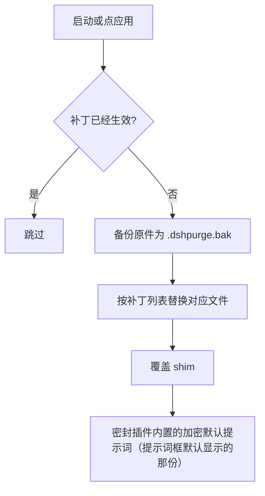
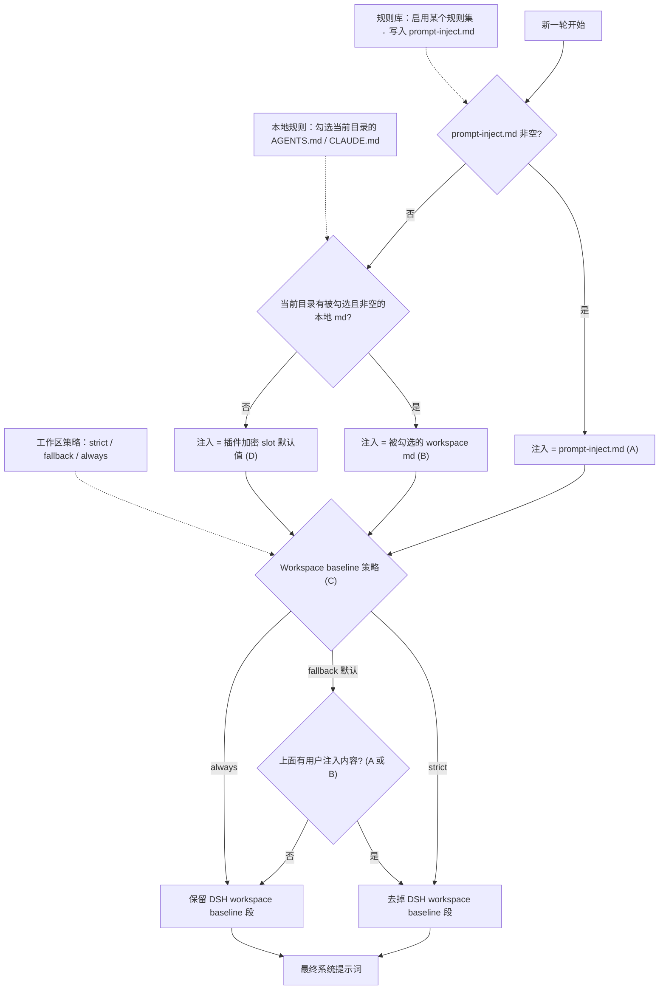

<div align="center">


# dsh-purge · DeepSeek Harness 破甲插件

**在官方 DSH 里，把「宿主层拦截」和「模型层回答」分开看清楚。**

红队评测 · 分组补丁 · 按模型换提示词 · 一键还原 · 适配 DSH `0.2.2-rc.3`

[](LICENSE)
[](https://github.com/qiuqianyi66/dsh-purge/releases/latest)
[](https://github.com/qiuqianyi66/dsh-purge/actions/workflows/test.yml)
[](https://github.com/qiuqianyi66/dsh-purge/stargazers)
[](https://www.deepseek.com/harness/)
[](package.json)
[](lib/core.js)
[](compat.json)
[](https://m8ven.ai/mcp/qiuqianyi66/dsh-purge?s=readme)
[](https://m8ven.ai/mcp/qiuqianyi66-dsh-purge-zqj82m7v=readme)

```sh
dsh plugin --profile web add https://codeload.github.com/qiuqianyi66/dsh-purge/tar.gz/refs/heads/main
```

桌面版把 `web` 换成 `desktop`。装完**完全退出再打开**，点会话标题旁的 **dsh-purge** →「清洗」→「应用」。

[30 秒上手](#30-秒上手) · [它解决什么](#它解决什么问题) · [能做什么](#能做什么) · [兼容与证据](#兼容与证据) · [升级前自检](#升级前先自检) · [FAQ](#常见问题-faq) · [合规边界](#strict-legal--compliance-disclaimer)

</div>

> ⚠️ **仅用于本机 / 内网授权靶场。** 开源版攻击任务只放行回环与 RFC1918 私网；禁止公网攻击、游戏外挂、倒卖。细则见[合规边界](#strict-legal--compliance-disclaimer)。

> **维护者（2026-11）**：本仓库是原始 dsh-purge（作者 **YuJunZhiXue**，上游已不再公开）的衍生作品，由 [@qiuqianyi66](https://github.com/qiuqianyi66) 维护分发，issue、更新与安装源以本仓库为准。当前 **1.1.90**，适配 DSH **0.2.2-rc.3**。许可证与原始版权见 [LICENSE](./LICENSE)、[NOTICE](./NOTICE)。

---

## 目录

- [30 秒上手](#30-秒上手)
- [它解决什么问题](#它解决什么问题)
- [能做什么](#能做什么)
- [兼容与证据](#兼容与证据)
- [安装](#安装)（含[手动](#manual)、[交给助手](#交给助手安装)、[卸载](#卸载)）
- [应用与验证](#应用与验证)
- [升级前先自检](#升级前先自检)
- [常见问题 FAQ](#常见问题-faq)
- [同类实现与差异](#同类实现与差异)
- [工作原理](#工作原理)
- [还原与更新](#还原与更新)
- [已知限制](#已知限制)
- [仓库结构](#仓库结构)
- [给 AI Agent 的协议](#给-ai-agent-的协议)
- [术语表](#术语表)
- [署名与许可证](#署名与许可证)

---

## 30 秒上手

| 步 | 做什么 | 完成标志 |
| --- | --- | --- |
| 1 | 跑上面那条安装命令（桌面把 `web` 换 `desktop`） | `profiles/<profile>/node_modules/dsh-purge/package.json` 存在 |
| 2 | **完全退出**刚装的那个宿主，再打开（桌面连托盘一起退） | 会话标题旁出现 **dsh-purge** |
| 3 | 点 **dsh-purge** →「清洗」→「应用」 | 自动重启一次，补丁状态变「已完成」 |
| 4 | 聊天里跑 `/purge status` | 输出当前补丁与规则集状态 |

四步缺一步都不算装好：只装插件不改 `@deepseek-ai` 包，宿主行为不会变。

---

## 它解决什么问题

DeepSeek Harness 不只是把问题转发给模型。运行时会改系统提示词、审批门、沙箱策略和会话格式——同一个问题，**宿主拦下来的地方和模型拒答的地方长得几乎一样**。

| 你看到的现象 | 实际可能是什么 | dsh-purge 做什么 |
| --- | --- | --- |
| 模型「不回答」 | 宿主审批门 / 沙箱策略先拦了 | 把宿主层策略改成可观测、可回滚的补丁，逐条比对原文 |
| 换模型结论变了 | 提示词被宿主改写，或按模型预设不同 | 按模型挂不同提示词，规则集可切换、可还原 |
| 升级 DSH 后插件「还在」却没效果 | 官方原文变了，pattern 没命中 = 静默失效 | 升级前离体审计（`audit:next`）+ 面板漂移诊断 |

它不写死盘符：按 `$DSH_HOME` → dsh 启动器旁的 `.dsh` → `~/.dsh` 探测。不改官方源码仓库，**只有点「应用」才写入本机文件**，每个文件先备份 `.dshpurge.bak`。

---

## 能做什么

**面板（会话标题旁的 dsh-purge）**

| 页 | 内容 |
| --- | --- |
| 清洗 | 分组查看 82 条补丁的状态；应用 / 还原 / 卸载；编辑提示词；多套规则集；白 / 墨两套外观 |
| 演练台 | 授权后查看资产与本机环境；开源版**不下发**预制技能库与知识库，未授权时标「未授权」 |

**命令行、聊天命令、模型工具**

```sh
dsh-purge --status
dsh-purge --diagnose [--json] [--all-hosts]   # 只读：补丁漂移诊断
dsh-purge --preupdate [--json]                # 只读：升级前预检
dsh-purge --apply | --revert | --uninstall | --edit | --help

/purge status | apply | revert | uninstall | edit | help
/rules list | use <id> | create <id> | delete <id> | reset
/skills list | import <路径> | create <id> [说明] | delete <id>
/rewind

purge_status   purge_apply   purge_revert        # 模型工具
```

> 别的插件已占 `/rewind`（或 `/purge`、`/rules`、`/skills`）时会跳过或改挂备用名，主插件的工具与 `/dsh-purge/*` 路由不受影响。

**补丁规模与覆盖**

82 条补丁分布在 **65 个载体键**（宿主里的具体文件），每条带 id、名称与可读说明。典型几条：

| 补丁 | 覆盖什么 |
| --- | --- |
| #82 | 双击桌面 exe 时常缺 `DSH_PROFILE`，主进程兜底；锚点只锚 import 单行，兼容新版插入 region |
| #13 / #35 | 沙箱升级阶梯与「从不拒绝」判定（rc.2 起换成 `SandboxEscalationError` 错误码形态） |
| #62 | 官方工具审批 `serviceAsk` 的 fail-open 分支（rc.2 起改走 `approvalDenial(...)`） |
| #36 | `sandbox_permissions` 的 justification 文案（含 rc.2 新增的 `Required with … this exact …` 整句） |
| #18 | 重复工具调用守卫（rc.2 删掉 post-execute 的 block 分支） |
| #21 | 旧版 10 分钟前台等待回落到官方 60 秒，只认插件自己的标记 |

**规则集与本地靶场**

多套 `AGENTS.md` / `CLAUDE.md`：启用写入 `$DSH_HOME`，删除从列表移除。本地靶场只放行回环与 RFC1918，域名**先解析再判 IP**，`.lab` / `.htb` 这类后缀本身不算例外。

---

## 兼容与证据

**1.1.90 已适配 DSH 0.2.2-rc.3**（含 rc.3 桌面版把运行时打进 `app.asar` 的新布局）；不要拿本版本去打 `0.1.x` 或 `0.2.1-rc.x`。

<!-- compat:table:start -->
| dsh 版本 | 本仓库版本 | 证据 | 说明 |
| --- | --- | --- | --- |
| **0.2.2-rc.3** | **1.1.90** | 契约✓ 实打✓ 冒烟✓ 真机✗ | rc.3 桌面版起把运行时打进 resources/app.asar；面板「应用」会自动解包、挪走 asar、重启。rc.2 引入 SandboxEscalationError / approvalDenial 新原文，rc.2 与 rc.3 四个载体文件逐字节一致 |
| **0.2.2-rc.1** | **1.1.88** | 契约✓ 实打✓ 冒烟✓ 真机✗ | 只有 rc.1 能用旧 pattern；rc.2 起（含 rc.3）需要 1.1.89 的新 pattern，装 1.1.88 会静默失配 |
| **0.2.1-rc.x** | unknown | — | 不是本版本目标；到 [Releases](https://github.com/qiuqianyi66/dsh-purge/releases) 选对应旧标签 |
| **0.2.0-rc.2** | **1.1.40+** | — | 旧线，见 [Releases](https://github.com/qiuqianyi66/dsh-purge/releases) |
| **0.1.7** | **1.1.39-** | — | 旧线（含 rc.1 / rc.2），在 [Releases](https://github.com/qiuqianyi66/dsh-purge/releases) 选对应标签 |
<!-- compat:table:end -->

**证据级别**（四种证据不合并成一句「支持」）：

- **契约**：官方包原文与补丁 pattern 逐条对齐——离体审计 `audit:next`。
- **实打**：在隔离树真打一遍补丁，产物过 `node --check`。
- **冒烟**：真宿主上 `--diagnose` 漂移 0、能启动。
- **真机**：应用到真宿主并完成面板 / 按钮的人工验收。

**0.2.2-rc.3 桌面版换了打包方式**：整个 dsh 运行时被塞进 `resources/app.asar`（209 MB），`resources/runtime` 为空，不再有 rc.1 那种 `resources/app/dsh` 明文目录。Electron 的加载顺序是 asar 优先于同名目录，所以补丁必须写进明文、并且让 asar 不再原位：

- 面板点「应用」：插件自动把 asar 解到 `resources/app`（451 MB、338 个 `@deepseek-ai` 包）、补上 `app.asar.unpacked` 里的原生件、把 asar 改名 `.bak`、重启宿主，全程不需要你动手。
- 命令行 `--apply`：不替你杀进程。写完补丁后如果 `app.asar` 还在原位，末尾会明确提示「宿主会优先读它」；退出宿主、把 `app.asar` 改名，再从 exe 启动即可。
- 命令行原先在 node 里跑，探不到 Electron 的 `resourcesPath`，会把自己当 web 宿主而整批跳过桌面壳补丁；1.1.90 起按 `aiBase` 是否落在 `resources/app/dsh/...` 自动判成 desktop，不再漏 `#82/#83` 这类补丁。

**最近一次机械验证（2026-11-16）**

| 项 | 结果 |
| --- | --- |
| rc.3 离体审计 | 载体 45 键 · 补丁 78 条 · 认得 56 · 校验型 6 · **需重对齐 0** · 未审计 11（载体不在 npm 包内） |
| rc.3 实打 | 58 applied / 6 already / 7 missing_file / 2 skipped / 9 na；改动 31 个 `.js`，语法失败 0 |
| 真宿主（0.2.2-rc.3 桌面版） | 82 条补丁 = **42 条文件核验命中**（其中 40 条靠 markers 确认）+ 29 条无文件字段（运行时注入，不落盘）+ 7 条本机无对应载体（可选：#28/#30/#31/#64/#65/#71/#76）+ 4 条已退役；**改过原文 0 · 目标已消失 0 · 载体缺失 0**；宿主自检日志记 `sealed:false`、`boot:host-untouched` |
| 单元测试 | 194 通过 / 0 失败 |
| 版本关系 | rc.2 与 rc.3 的四个载体文件**逐字节一致**，失配源自 rc.2 的原文改动 |

数字的机器可读版在 [`compat.json`](./compat.json)，与矩阵同源（`lib/compat-matrix.js`），由 `npm run compat:check` 在 CI 里核对，不会和 README 走散。

---

## 安装

**不要走插件市场**：`dsh-plugin.org` 或设置里的一键安装会报 `already queued: dsh-purge`。npm 仓库没有 `dsh-purge` 这个名字，不要 `pnpm add dsh-purge`。

| 场景 | 做法 |
| --- | --- |
| 有 `dsh` CLI | `dsh plugin --profile web add https://codeload.github.com/qiuqianyi66/dsh-purge/tar.gz/refs/heads/main`（桌面换 `desktop`；已在仓库根时用 `add .`） |
| 只有 pnpm | 进 `$DSH_HOME/profiles/web`（桌面 `profiles/desktop`）后 `pnpm add` 同一地址 |
| 桌面客户端 | 点[一键安装](dsh://plugin/install?id=dsh-purge&name=dsh-purge&version=1.1.89&repo=qiuqianyi66%2Fdsh-purge&permissions=%E7%B3%BB%E7%BB%9F%E6%8F%90%E7%A4%BA%E8%AF%8D%E6%B3%A8%E5%85%A5%2C%E6%9C%AC%E6%9C%BA%E8%A1%A5%E4%B8%81%2C%E8%AE%BE%E7%BD%AE%E9%A1%B5&downloadUrl=https%3A%2F%2Fcodeload.github.com%2Fqiuqianyi66%2Fdsh-purge%2Ftar.gz%2Frefs%2Fheads%2Fmain)（`dsh://` 唤起，下载同一份压缩包） |
| 命令都不行 | 见[手动安装](#manual) |

压缩包地址只用 `codeload.github.com` 写法；`github.com/.../archive` 会 302，pnpm 报 `fetch failed`。

pnpm 11/12 默认拦安装脚本（`ERR_PNPM_IGNORED_BUILDS`），带上允许构建：

```sh
pnpm add --allow-build=dsh-purge --allow-build=dsh-purge@https://codeload.github.com/qiuqianyi66/dsh-purge/tar.gz/refs/heads/main https://codeload.github.com/qiuqianyi66/dsh-purge/tar.gz/refs/heads/main
# 已装上但只有警告时，必须带完整 specifier（只写 dsh-purge 会留下 "set this to true or false"）：
pnpm approve-builds dsh-purge@https://codeload.github.com/qiuqianyi66/dsh-purge/tar.gz/refs/heads/main
# bundles / insert 还没写上时再补：
node node_modules/dsh-purge/scripts/ensure-profile-bundle.mjs
```

**完成标志**：`node_modules/dsh-purge/package.json` 在；该 profile 的 `dsh.profile.bundles` 里有 `"dsh-purge"`；`cordis.patch.yml` 里有 `id: dsh-purge` 的 insert。缺 insert，宿主不加载插件，界面也没有按钮。

<a id="manual"></a>

### 手动安装

命令装不上、或 `dsh` 不在 PATH 时用这个。只改**正在用的那个宿主**对应的 profile。

<details>
<summary><strong>五步手动步骤（含踩坑）</strong></summary>

**1. 找到真正在用的 `$DSH_HOME`。** 认目录：名字是 `.dsh`（官方 EXE 偶见 `dsh-home`），里面有 `profiles`，且至少有一个 `profiles/<名>/package.json`。顺序：`DSH_HOME` → 安装根旁的 `.dsh` → `%USERPROFILE%\.dsh` → `%APPDATA%` / `%LOCALAPPDATA%\DeepSeek Harness\dsh-home`。确认 `profiles/web/package.json` 的 `"name"` 是 `dsh-profile-web`（桌面是 `dsh-profile-desktop`）。本机常有两份 `.dsh`，用你**实际启动**的那个。

```powershell
$cands = @()
if ($env:DSH_HOME) { $cands += $env:DSH_HOME }
$cands += "$env:USERPROFILE\.dsh"
$dsh = Get-Command dsh -ErrorAction SilentlyContinue
if ($dsh) {
  $dir = Split-Path $dsh.Source
  $cands += @((Join-Path $dir ".dsh"), (Join-Path (Split-Path $dir) ".dsh"), (Join-Path (Split-Path (Split-Path $dir)) ".dsh"))
}
$cands += @("$env:APPDATA\DeepSeek Harness\dsh-home", "$env:LOCALAPPDATA\DeepSeek Harness\dsh-home")
$cands | Select-Object -Unique | Where-Object { $_ -and (Test-Path (Join-Path $_ "profiles")) }
```

**2. 把插件放到 `$DSH_HOME/plugins/dsh-purge`**（目录名与 `package.json` 里的 `"name"` 都必须是 `dsh-purge`）。

```sh
git clone https://github.com/qiuqianyi66/dsh-purge.git "$DSH_HOME/plugins/dsh-purge"
```

没有 git：下 [main.tar.gz](https://github.com/qiuqianyi66/dsh-purge/archive/refs/heads/main.tar.gz)，解压后把 `dsh-purge-main` 改名为 `dsh-purge` 放进 `plugins`。别只拷几个 `.js`。

**3. 只改对应 profile 的 `package.json`（先备份）**，只追加两处，原有依赖与 bundle 全留：`dependencies` 加 `"dsh-purge": "file:../../plugins/dsh-purge"`，`dsh.profile.bundles` **末尾**加 `"dsh-purge"`（已有就别加）。JSON 要合法；`file:` 路径别换成绝对路径；`patchReload`、其它插件、版本号都别动。

**4. 只在刚改的那个 profile 目录装依赖**（`cd` 进 profile，不要在仓库根）：

```sh
cd "$DSH_HOME/profiles/web"   # 或 profiles/desktop
pnpm install
```

成功标志：`profiles/<web|desktop>/node_modules/dsh-purge/package.json`。`Could not resolve` 就查 `file:` 路径；JSON 报错就修逗号或还原备份。

**5. 完全退出该宿主 → 重开 → 点「应用」**（或 `/purge apply`）。按钮没出现多半是改错了另一份 `.dsh`，回第 1 步核对。

</details>

<a id="交给助手安装"></a>

### 交给助手安装

把下面整段发给本机助手。它只执行安装命令：不搜索全盘、不改其它文件、不代点「应用」、不重启。

<details>
<summary><strong>给 AI 助手（只安装）</strong></summary>

<!-- AI-AGENT-START -->

安装 DeepSeek Harness 插件 `dsh-purge`，只装到你正在用的那个 profile（Web 用 `web`，桌面用 `desktop`）。不要全盘搜索，不要读或改其它文件，不要应用设置，也不要重启应用。不要走插件市场；npm 仓库没有这个包名，不要 `pnpm add dsh-purge`。

有 `dsh`：

```sh
dsh plugin --profile web add https://codeload.github.com/qiuqianyi66/dsh-purge/tar.gz/refs/heads/main
```

没有 `dsh`、只有 pnpm：进 `$DSH_HOME/profiles/web`（常见 `~/.dsh/profiles/web`）后 `pnpm add` 同一地址。当前目录已是本仓库且有 `dsh` 时用 `add .`。`dsh` 和 pnpm 都没有，就停下来告诉用户。

装完提醒用户：完全退出并重启宿主，再点会话标题旁的 **dsh-purge** →「清洗」→「应用」，然后停止。

<!-- AI-AGENT-END -->

</details>

### 卸载

先「还原」（若已应用），再「卸载」：删除注入文件与规则库，插件目录在宿主重启后清理。命令行或聊天里也可以 `/purge uninstall`。

---

## 应用与验证

「应用」做的事：备份原件 → 按补丁列表替换对应文件 → 覆盖 shim → 密封插件内置的加密默认提示词。重复应用是**幂等**的；应用成功后宿主自动重启一次，以加载改过的包文件。

验证顺序：

```sh
dsh-purge --status      # 或聊天里 /purge status
dsh-purge --diagnose    # 只读：每条补丁是「已完成 / 待应用 / 漂移 / 载体缺失」
```

三种状态要分清：**待应用**（原文命中、还没写）、**漂移**（官方原文变了，pattern 打不上，需要重对齐）、**载体缺失**（这台宿主没装那个包，正常跳过）。

---

## 升级前先自检

DSH 每次发预发布都可能改掉被补丁锚定的原文。改一点点，pattern 就再也命中不了——插件看起来装好了、面板也还在，但**补丁一条都没生效**，这就是「静默失效」。

所以在升级宿主**之前**先跑离体审计：按官方 npm 包铺一棵隔离树，用插件自己的匹配引擎逐条试补丁，不碰你正在用的宿主。

```sh
npm run audit:next -- --version 0.2.2-rc.3            # 只报告
npm run audit:next -- --version 0.2.2-rc.3 --fail-on drift   # 有需重对齐就退出码 1（CI 门禁）
```

判据四态：`认得` / `校验型`（只验 marker，无替换）/ `需重对齐`（载体在、原文不中）/ `未审计`（该版本没有这个包）。**只有 `需重对齐 0` 才算能升。** 「认得」不等于「支持」——真机验收仍需装上升完的宿主再看一次面板。

日常巡检（宿主 / 矩阵 / 上游三方对齐）：

```sh
node scripts/upstream-sync.mjs --offline   # 或 --plan / --json
```

本机版本落后于矩阵目标时，它报 `HOST_BEHIND_MATRIX`，并且不会把矩阵目标 `--bump` 往回推。

---

## 常见问题 FAQ

### dsh-purge 是什么？

DeepSeek Harness（DSH）的本机插件：用分组补丁和可替换提示词，把宿主层策略拦截与模型层回答分开观测，用于受控的 LLM 安全评测，也用来判断默认策略是否过紧。

### 支持哪个版本的 DSH？

1.1.89 适配 `0.2.2-rc.3`（`dshTarget` 同值），同时支持官方 `dsh web` 与官方桌面 EXE，要求 Node.js ≥ 18。`0.2.1-rc.x` 不在本版本目标内，去 [Releases](https://github.com/qiuqianyi66/dsh-purge/releases) 选旧标签。

### 装了插件，为什么会话标题旁没有按钮？

最常见是两处没写：profile 的 `dsh.profile.bundles` 里没有 `"dsh-purge"`，或 `cordis.patch.yml` 里没有 `id: dsh-purge` 的 insert。跑 `node node_modules/dsh-purge/scripts/ensure-profile-bundle.mjs` 补上，然后完全重启宿主。

### 应用后模型行为没变？

先跑 `dsh-purge --diagnose`。看到「漂移」说明官方原文变了、pattern 没命中，需要重对齐（或在插件里切到适配当前宿主的版本）；看到「待应用」说明还没写文件，去点「应用」；看到「载体缺失」是这台宿主没有那个包，属正常跳过。

### 升级 DSH 之后插件会怎样？

两种结果：原文没变→继续命中；原文变了→补丁待应用或跳过，宿主不会被乱改，但**也不会生效**。所以升级前跑 `audit:next`，升级后跑 `--diagnose`。

### 安装会改 DeepSeek Harness 源码吗？

只在你点「应用」时写入本机目标文件，每个文件先备份 `.dshpurge.bak`；随时可在「清洗」里还原。不改任何官方远程仓库。

### 为什么面板数字和别人的不一样？

面板按宿主 **surface** 统计：Web 与桌面是两套基线，同一台机器上看 Web 面和桌面面本来就会不同。比较数字之前先确认是同一个面、同一个宿主版本。

### 能用来攻击公网目标吗？

不能。开源版攻击任务只允许本机回环与 RFC1918 私网靶场，解析到公网一律拦；仓库内不含公网扫描器或对外攻击载荷。

### 是免费的吗？许可证是什么？

开源版免费，Apache License 2.0。二开、再分发必须保留 `LICENSE`、`NOTICE` 与署名 [qiuqianyi66/dsh-purge](https://github.com/qiuqianyi66/dsh-purge)（原始作者 YuJunZhiXue）；禁止倒卖与收费挂群。

### 适配新版本要多久？

看宿主改了什么：改文案（如 #36 一句 justification）只需补一条 pattern；改判定结构（如 rc.2 把 throw 换成 `SandboxEscalationError`、把拒绝换成 `approvalDenial`）要按载体重写锚点。做法一律是**追加新 pattern、保留旧 pattern**，老宿主不掉档。

---

## 同类实现与差异

DSH 生态里改宿主源码的插件很少，dsh-purge 是其中之一，历史上出现过几条线。下面是 2026-11-15 复核到的状态（以各仓库自述与 `package.json` 为准）：

| 线 | 状态 |
| --- | --- |
| 原仓库 `YuJunZhiXue/dsh-purge` | 已删除 / 转私有；最后制品只验到 `0.2.2-rc.1` |
| 镜像 `mmparko/dsh-purge` | 冻结在 `1.1.71` / `dshTarget 0.2.0-rc.2` |
| 本仓库 `qiuqianyi66/dsh-purge` | `1.1.89` / `0.2.2-rc.3`，带离体审计、证据级别与 `compat.json` |

**怎么自己核实一个分支「真的适配了新版本」**：不要只看它的 `dshTarget` 或版本号，去它的 `lib/core.js` 里搜新版本引入的原文，例如 `SandboxEscalationError`、`approvalDenial`、`this exact`。搜不到，就说明这组 pattern 没补，装上去会静默失配。

---

## 工作原理

应用（启动时或手动点「应用」）：



每一轮的提示词注入与规则集决策（虚线表示三个输入各自驱动哪一步）：



一条补丁由 `id`、一个或多个 `file`（载体键）、若干 `pattern` 与 `replacement` 组成；`marker` 用来判断是否已生效。宿主原文对不上时返回「漂移」，而不是假装成功——这是本插件与「静默失效」的分界线。

---

## 还原与更新

- 每个目标文件应用前备份为 `<文件>.dshpurge.bak`；「还原」用备份覆盖回去并删除备份；没有备份时去掉 shim 里本插件写入的行。`prompt-inject.md` 是用户文件，还原时保留。
- 更新与历史包见 [Releases](https://github.com/qiuqianyi66/dsh-purge/releases)。补丁标题下有正式版与测试版，测试版跟 `beta` 分支；「切换到正式版」装回 main 并清掉钉选。
- 不改动非 `@deepseek-ai` 的第三方插件源仓库；启动时对已装的 doctor / market / mnemon 之类**尽力**修补，属运行时行为。

---

## 已知限制

- 补丁锚定的是**官方原文**。宿主改动越结构性，重对齐成本越高；本插件能做的是把「失效」变成可见的漂移，而不是预测上游改动。
- 面板与按钮类验收依赖真人操作；CI 只能覆盖到「契约 + 实打 + 单元测试」。
- 社区桌面端不维护；官方 npm-global 安装不打补丁。
- 密封的 `host-commands` / `runtime-commands` 会被清洗，绝不注入。
- `0.1.x` 与 `0.2.1-rc.x` 不在本版本目标内。

---

## 仓库结构

```
dsh-purge/
├── bin/                    # 命令行入口
├── lib/                     # 补丁引擎、规则集、技能、演练台、红队运行时
│   ├── core.js              # 全部补丁定义（pattern / replacement / marker）
│   ├── compat-matrix.js     # 兼容矩阵与证据级别（单一事实来源）
│   └── ...
├── presets/redteam/         # 红队预设
├── scripts/
│   ├── audit-next.mjs       # 新版本离体审计（升级前跑）
│   ├── upstream-sync.mjs    # 宿主/矩阵/上游三方巡检
│   ├── gen-compat-readme.mjs# 由矩阵生成 README 表与 compat.json
│   └── ensure-profile-bundle.mjs
├── test/                    # 单元测试（node --test）
├── client.js                # 侧栏与面板
├── compat.json              # 机器可读兼容矩阵（生成物）
├── cordis.patch.yml         # profile 打包补丁
└── docs/                    # banner、披露与历史文档
```

运行时文件在 `$DSH_HOME`：`prompt-inject.md`、`rules/`、`redteam/`。Web 与桌面各用自己那一份主目录。开源版不下发预制技能库与知识库。

---

## 给 AI Agent 的协议

如果你是 agent，被要求安装、检查或升级本插件：

1. **先读 [`compat.json`](./compat.json)**：里面有当前 `version` / `dshTarget` / 矩阵 / 证据级别 / 安装命令 / 审计命令。不要让用户去猜版本。
2. **只装 `dsh-purge`**：不要 `pnpm add dsh-purge`（npm 没有这个名字），不要走插件市场（会报 `already queued`）。用 `codeload.github.com` 的 tar.gz 地址。
3. **只改用户正在用的 profile**：Web 与桌面分开；不要一次装两个。
4. **不要代点「应用」、不要替用户重启**：应用会写本机 `@deepseek-ai` 包，必须由用户在面板里确认。
5. **升级前跑审计**：`npm run audit:next -- --version <目标版本> --fail-on drift`；`需重对齐` 非 0 就先报告，不要建议升级。
6. **不要把审计结论说成「已兼容」**：契约 / 实打 / 冒烟 / 真机是四个级别，文档里按级别说。

---

## 术语表

| 词 | 含义 |
| --- | --- |
| DSH | DeepSeek Harness，本插件作用的宿主运行时 |
| dsh plugin | 官方插件安装命令；profile 决定装到 Web 还是桌面 |
| profile | 宿主的插件集合与配置单元，如 `profiles/web`、`profiles/desktop` |
| 载体（carrier） | 被补丁改写的具体宿主文件，如 `dsh-sandbox/lib/index.js` |
| pattern / replacement | 补丁锚定的官方原文片段 / 替换后的内容 |
| 漂移（drift） | 载体还在，但官方原文变了，pattern 再也命中不了 |
| 校验型 | 只验 marker、没有 replacement 的补丁，不算漂移 |
| 密封提示词 | 插件内置的加密默认提示词，面板里默认显示那份 |

---

## 署名与许可证

本仓库使用 [Apache License 2.0](./LICENSE)。二开、再分发必须保留版权声明和 [NOTICE](./NOTICE)，写明来源 [qiuqianyi66/dsh-purge](https://github.com/qiuqianyi66/dsh-purge)（原始作者 YuJunZhiXue）。

**原版不允许倒卖。** 不得收费转卖、换皮上架、当货挂群。借用本项目的名称、思路、代码或提示词，同样必须署名并写明来源仓库。隐瞒来源、改头换面据为己有，或把原版拿去倒卖，作者将依法追究责任。

---

<a id="strict-legal--compliance-disclaimer"></a>

### ⚠️ 严正法律免责与合规使用声明

**免责声明：** 本项目为非营利开源项目，遵守国家法律法规及所在平台的相关规范，仅供学习与研究使用。不得将本项目用于任何违法违规用途；由此产生的后果由使用者自行承担。

**【零容忍严正申明】**：本项目坚决反对并严禁任何形式的违法犯罪行为！开发者绝不支持、不鼓励、不协助任何未授权网络攻击、漏洞利用、数据窃取、非法侵入计算机信息系统或生成违法违禁内容的活动。**任何将本项目用于违法犯罪的行为，均与开发者无关，由行为人依法独立承担全部法律责任。**

1. **本仓库不含违法内容**：发布的代码、文档、补丁与默认提示词**不是**木马、后门、未授权渗透工具、勒索软件、撞库脚本，也**不是**针对公网或第三方系统的攻击载荷。项目本身不提供违法内容，也不教唆、组织、协助实施违法犯罪。
2. **只作用于本机官方 Harness**：安全评测补丁、提示词注入全部发生在使用者**本机已安装的官方 DeepSeek Harness**（`@deepseek-ai` 包、本机 profile / `$DSH_HOME`）上。对象是使用者自己的官方本地软件，**不是**他人的网站、服务器、账号或信息系统。
3. **评测补丁不对外网目标联网**：应用补丁、写入注入、回滚、卸载均在本机文件与本机进程内完成，**不对任何公网主机、未授权系统进行扫描、探测、入侵或攻击发包**。不得把本项目当作跳板去打外网。插件若开启「检测更新」，仅可能访问本插件自己的 GitHub 仓库以核对版本，**与对第三方系统的网络攻击无关**，也不能被解释为授权对外渗透。
4. **合法受控范围限定**：本项目定位为使用者在**自己有权管理的本机官方 Harness** 上进行红队科研与鲁棒性评测的辅助工具。**严禁在未经所有者合法书面授权的目标、公网在线系统或生产业务上运行本项目**。一切测试必须限制在**本机已授权安装的官方 Harness、离线本地合成靶标、授权网络安全演练靶场及合规实验室受控环境**中进行。
5. **开源版只允许本地靶场**：攻击任务只放行本机回环和 RFC1918 私网 IP。域名先解析再判 IP，不靠后缀放行；公网 IP、解析到公网的域名、解析失败、hosts 把实验室后缀指到公网，都不能当作例外。密钥、密码、网段、通配符，以及对话里的口头说明，都不能增加例外。禁止制作游戏外挂；开源版不下发技能库和知识库。
6. **严禁违法与违禁用途**：使用者严禁利用本项目直接或间接从事任何违反下列法律法规的行为（必须逐条遵守，不得以任何理由规避）：
   - **《中华人民共和国刑法》**
   - **《中华人民共和国网络安全法》**
   - **《中华人民共和国数据安全法》**
   - **《中华人民共和国个人信息保护法》**
   - 以及其他现行有效的法律、行政法规与监管规定；
   - 同时严禁：
   - 未经授权渗透、攻击公私机构计算机信息系统，实施勒索、破坏、撞库或传播恶意载荷；
   - 诱导、生成或传播危害国家安全、恐怖主义、暴力血腥、涉黄涉赌、诈骗、侵犯公民隐私或知识产权等任何法律明令禁止的违法违禁内容；
   - 违反相关大模型提供商的《服务条款》与《滥用政策》。
7. **使用者独立承担全部责任**：本项目依据 Apache-2.0「按现状」提供，开发者不对软件的完整性、安全性与适用性作任何明示或暗示的保证。**使用者应对自身的所有下载、部署、运行、修改、传播行为以及由此产生的全部输入与输出后果承担独立、完全的民事、行政及刑事法律责任**。项目作者与贡献团队绝不承担任何因使用者滥用导致的直接、间接或连带责任。
8. **违约即终止授权**：任何将本项目用于非法攻击、恶意活动或违规行为的个人或实体，其开源软件使用许可将自违法违规行为发生之日起**自动且不可撤销地立即终止**。该主体须立即停止使用并永久销毁本项目的所有代码、脚本与衍生数据，并依法承担相应法律制裁。
9. **第三方独立性声明**：本项目属于完全独立的开源安全评测研究项目，与 DeepSeek 官方或其关联主体无任何隶属、商业合作、授权或官方背书关系。文中「官方」仅指评测对象为使用者本机安装的官方 DeepSeek Harness 软件包，**不代表** DeepSeek 官方开发、认可或担保本插件。
10. **必须署名**：借用本项目的名称、思路、代码或提示词，必须署名并标明本仓库。不署名将依法追究责任。详见[署名与许可证](#署名与许可证)。

---

**English**: dsh-purge is an Apache-2.0 red-team evaluation plugin for [DeepSeek Harness](https://www.deepseek.com/harness/) (DSH). It ships 82 grouped host patches plus per-model prompt presets, so you can tell a host-layer policy block apart from a model refusal inside your own local install. Current release **1.1.89** targets DSH **0.2.2-rc.3**; before upgrading DSH, run `npm run audit:next -- --version <version>` and require `drift 0`. Machine-readable matrix: [`compat.json`](./compat.json). Full English README: [`README.en.md`](./README.en.md).
